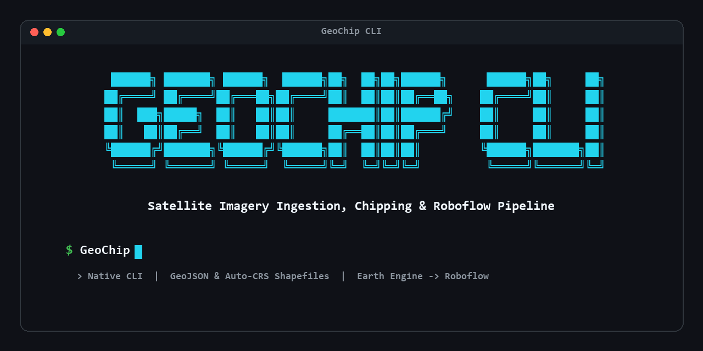
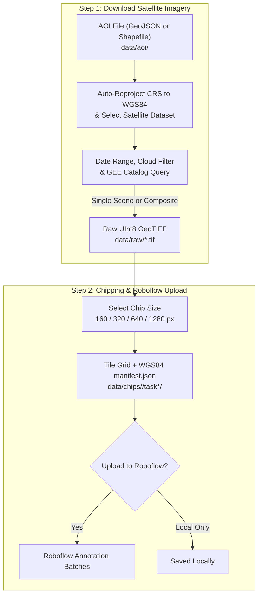

# GeoChip CLI

<p align="center">
  <b>Beginner-Friendly Satellite Imagery Ingestion, Raster Chipping, and Roboflow Annotation Pipeline</b>
</p>

<p align="center">
  
  
  
  
  
</p>

<p align="center">
  
</p>

---

## Overview

**GeoChip CLI** is a native Python command-line tool that guides you from defining an Area of Interest (AOI) to downloading cloud-filtered satellite imagery from **Google Earth Engine (GEE)**, slicing rasters into ML-ready image chips, and uploading labeled task batches to **Roboflow**.

No Docker Desktop, WSL 2, or manual GDAL setup is required — install in seconds and run `GeoChip` directly from any terminal.

### Key Highlights

- **Simple Native Command**: Just run `GeoChip` (or `geochip`) in your terminal — no `python main.py` or containers needed.
- **Beginner-Friendly Interactive UI**: Arrow-key menus, live GEE/Roboflow connection status badges, date validation, progress spinners, and a **Quick Start: Full Pipeline** mode.
- **GeoJSON & Auto-Reprojected Shapefiles**: Drop a single `.geojson` file (e.g., from [geojson.io](https://geojson.io)) or an ESRI `.shp` file in any projection (including UTM); GeoChip CLI automatically reprojects it to WGS84 (`EPSG:4326`).
- **Multi-Sensor Earth Observation Catalog**:
  - **Copernicus Sentinel-2 L2A (10m)** — Optical multispectral with QA60 + SCL cloud masking
  - **USGS Landsat 9 & Landsat 8 C2 L2 (30m)** — Surface reflectance with `QA_PIXEL` masking
  - **Copernicus Sentinel-1 SAR GRD (10m)** — All-weather, cloud-penetrating radar
  - **MODIS Terra Surface Reflectance (250m/500m)** — Daily global revisit
  - **NASA SRTM Digital Elevation Model (30m)** — Global elevation terrain
- **Single-Scene or Cloud-Free Composite**: Pick an individual acquisition or merge scenes with **Median**, **25th Percentile (Q25)**, **Mean**, or **Lowest Cloud Cover**.
- **Raster Chipping & WGS84 Manifest**: Slice GeoTIFFs into `160×160`, `320×320`, `640×640`, or `1280×1280` px PNG chips grouped into task batches with a WGS84 `manifest.json`.
- **Direct Roboflow Upload**: Push task folders straight to Roboflow as annotation batches, with masked secret handling.

---

## Architecture & Pipeline Flow



---

## Quickstart Installation

**Requirement:** Python **3.10+** (modern geospatial wheels bundle GDAL and PROJ automatically).

### Option 1: One-Command Installer (Recommended for Beginners)

**Windows (PowerShell):**
```powershell
irm https://raw.githubusercontent.com/Anovvy/GeoChip-CLI/main/scripts/install.ps1 | iex
```

**macOS / Linux (Bash):**
```bash
curl -fsSL https://raw.githubusercontent.com/Anovvy/GeoChip-CLI/main/scripts/install.sh | bash
```

### Option 2: Install via `pip` / `pipx`

```bash
pip install git+https://github.com/Anovvy/GeoChip-CLI.git
```

### Launch GeoChip CLI

```bash
GeoChip
```

To verify your installed version or run inside a specific project folder:

```bash
GeoChip --version
GeoChip --work-dir path/to/project
```

---

## Preparing Your Area of Interest (AOI)

Place one or more AOI files inside `data/aoi/` in your working folder:

- **GeoJSON (Recommended for Beginners)**: Draw a polygon at [geojson.io](https://geojson.io), save as `.geojson`, and drop that single file into `data/aoi/`.
- **ESRI Shapefile**: Place `.shp`, `.shx`, `.dbf`, and `.prj` inside `data/aoi/`. Projected coordinate systems (such as UTM) are automatically reprojected to WGS84 (`EPSG:4326`).

---

## Credentials Setup

Credentials are stored securely in `~/.config/geochip/.env` (with optional local `.env` overrides), so they work across any directory:

1. Run `GeoChip` and choose **`🔑 Setup Credentials & Authentication`** (or run `GeoChip auth`).
2. **Google Earth Engine**: Sign in via browser OAuth and enter your GCP Project ID (registered for Earth Engine at [console.cloud.google.com/earth-engine/configuration](https://console.cloud.google.com/earth-engine/configuration)).
3. **Roboflow (Optional)**: Enter your Private API Key (masked on input), Workspace Slug, and Target Project ID.

---

## CLI Subcommands (Scripting & Automation)

```bash
# Interactive main menu
GeoChip

# Authentication setup
GeoChip auth --login
GeoChip auth --roboflow

# Download satellite imagery interactively
GeoChip download

# Slice a GeoTIFF into chips headlessly
GeoChip chip --raster data/raw/sentinel-2_AOI-1_median.tif --chip-size 640 --chips-per-task 5

# Upload generated batches to Roboflow
GeoChip upload --chips-dir data/chips/sentinel-2_AOI-1_median --task all
```

---

## Repository Structure

```text
GeoChip-CLI/
├── .github/
│   ├── scripts/
│   │   └── devops_pr_reviewer.py   # AGY SDK Senior DevOps PR Reviewer (4-tier Gemini fallback)
│   ├── workflows/
│   │   ├── ci.yml                  # PR CI: Ruff, Pytest, Build, Bandit, CodeQL, pip-audit, AGY review
│   │   └── cd.yml                  # Tag CD: SemVer dist/ build, Canary Pre-Release, Prod promotion
│   └── dependabot.yml              # Automated dependency & action updates
├── docs/
│   └── assets/
│       └── hero-banner.gif         # Terminal hero banner animation
├── geochip/
│   ├── __init__.py                 # Package exports & version (3.0.0)
│   ├── auth.py                     # GEE OAuth & Roboflow credential setup
│   ├── cli.py                      # Main GeoChip CLI entrypoint & subcommands
│   ├── config.py                   # Global/local .env config, workspace paths & secret masking
│   ├── datasets.py                 # Satellite catalog definitions & cloud masks
│   ├── downloader.py               # Optimized GEE query, compositing & GeoTIFF download
│   ├── geometry.py                 # GeoJSON & Shapefile loader with auto CRS reprojection
│   ├── tiler.py                    # Raster chipping & WGS84 manifest.json generator
│   ├── ui.py                       # Interactive menus, spinners & masked prompts
│   └── uploader.py                 # Roboflow batch uploader
├── scripts/
│   ├── install.ps1                 # Windows one-command installer
│   └── install.sh                  # macOS/Linux one-command installer
├── tests/                          # Offline unit & regression test suite
├── AGENTS.md                       # Engineering, CI/CD, Git & multi-agent governance
├── CHANGELOG.md                    # Release history (Keep a Changelog)
├── cliff.toml                      # Automated changelog generator config
├── LICENSE                         # MIT License
└── pyproject.toml                  # Package metadata, GeoChip scripts & tool configs
```

---

## Development & Release Workflow

1. Create a feature branch from `main` and make atomic commits following [AGENTS.md](AGENTS.md).
2. Open a Pull Request targeting `main` — CI runs linting, matrix tests, wheel build checks, Bandit/CodeQL SAST, `pip-audit`, and the **AGY SDK Senior DevOps PR Reviewer**.
3. After the Project Owner merges the PR, pushing a SemVer tag (`vMAJOR.MINOR.PATCH`) triggers CD to build `dist/`, publish a Canary Pre-Release, and promote to Production after manual approval.

---

## License

This project is licensed under the [MIT License](LICENSE).
